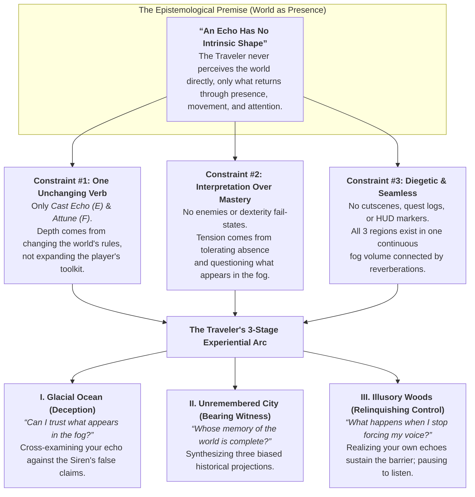
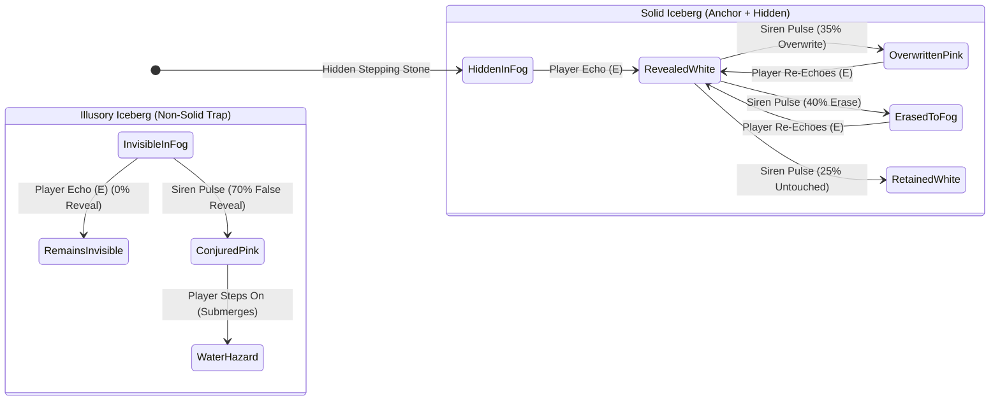
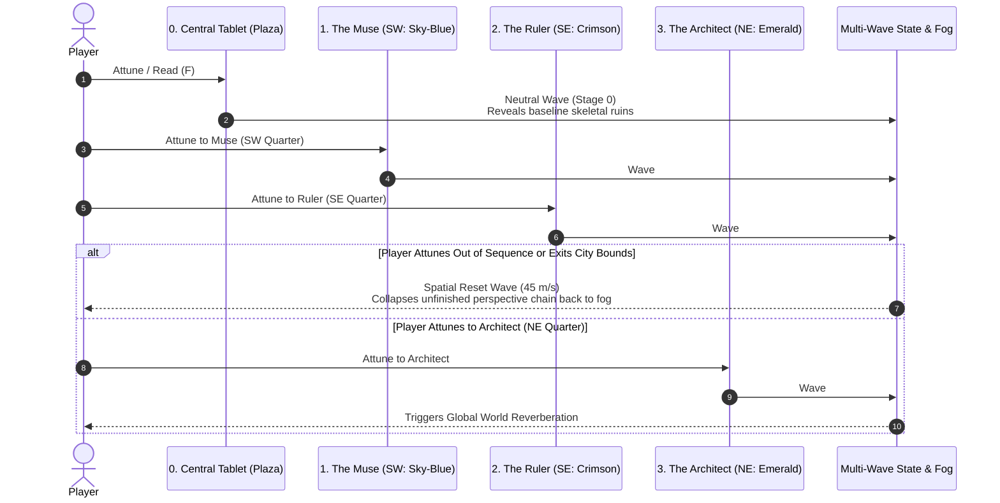
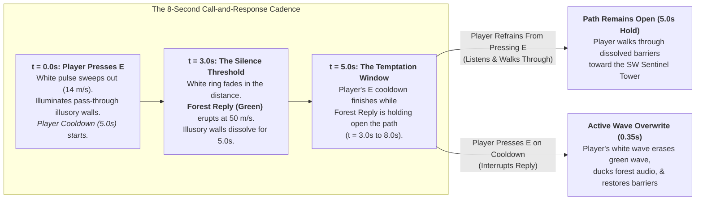
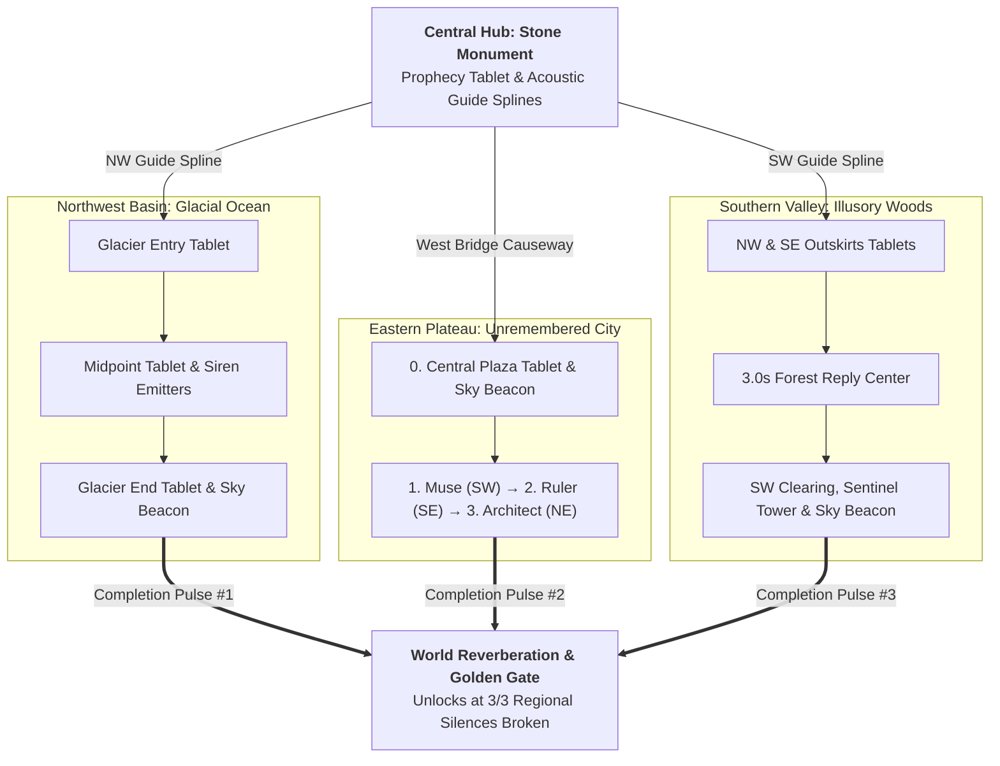

# *An Echo Has No Shape* : Design Case Study & GDD (`leficious.com`)

> **Role:** Solo Game Designer & Developer | **Timeline:** 4 Weeks (~1 Month) | **Engine:** Unity 6 (`URP`, C#)  
> **Context:** Developed for Peter Brinson's course at USC around the Situated Player Role of **The Traveler (*World as Presence*)**  
> **Links:** [Play on itch.io](https://leficious.itch.io/an-echo-has-no-shape) | [Official Trailer](https://youtu.be/AAVAfjhv6IA) | [Full Playthrough](https://youtu.be/fQMKXwIIvok) | [Live Case Study](https://leficious.com/projects/an-echo-has-no-shape)  
> **Design Premise:** *How far can a single, unchanging 1-button echolocation verb carry a multi-region labyrinth without ability creep, combat, or non-diegetic UI, simply by altering the epistemic rules of how the world answers back?*

---

## 1. Core Design Philosophy: *The Traveler*, Presence, and One-Verb Restraint

### 1.1 Origin: *The Traveler* (*World as Presence*)
***An Echo Has No Shape*** originated as a solo one-month project for Peter Brinson's class at USC, built around his design framework **Situated Player Role: The Traveler (*World as Presence*)**.

In Brinson's taxonomy, the *Traveler* differs from the *Investigator* in how meaning is constructed: rather than piecing together forensic clues about a past event, the Traveler experiences a world in the present tense through movement, attention, and tolerance of absence. Brinson frames this role with a familiar philosophical riddle: *if a tree falls in the woods and no one is there to hear it, does it make a sound?* For the Traveler, the answer is **no**. Narrative is constituted by presence: where the player walks, when they pause, and what they stop to see or hear determine what the world reveals.

The project brief asked for a multicursal labyrinth that guides the player through three experiential stages (*feeling lost with a sense of wonder -> recognizing a suspected pattern -> finding their way through personal interpretation*) and posed a central design question:
> *"Primarily, The Traveler finds a path and bears witness to unfolding events. What else might The Traveler do? Chooses, listens, backtracks, opens? For the player, is this assignment, ultimately, about losing power, or realizing they never had it?"*

### 1.2 The Mechanical & Production Constraint: One Verb in One Month
To translate *World as Presence* into a first-person mechanic within a **one-month solo production window**, I framed the project around a strict mechanical constraint: **Can a single, unchanging 1-button verb (`Press E to Cast Echo`) sustain a three-region labyrinth without introducing inventory upgrades, secondary abilities, or combat?**

Most echolocation or sonar games treat sound as a binary visibility toggle: you emit a pulse, a ring sweeps across the room, and the environment reveals its objective 3D geometry. Once the visual novelty wears off, the mechanic stops evolving because the relationship between the input and the information it returns remains static. Keeping the player's action set fixed to a single button solved both a philosophical problem and a four-week scoping problem: instead of splitting development time across secondary gadgets, the entire month could go into building three distinct regional labyrinths where progression comes from **destabilizing the relationship between the player's echo and objective reality**.

### 1.3 The Absurdist & Epistemological Core
The title is literal: **an echo has no intrinsic shape of its own.** It is a formless wave that borrows the contour of whatever surface stands in its way, and what returns to the listener is always partial, delayed, or distorted.

Tonally, the world is structured as a solitary pilgrimage with a quiet absurdist undertone, drawing on the sparse landscapes of Samuel Beckett and the epistemological labyrinths of Jorge Luis Borges:
- Monumental ruins, sentinel towers, and stone tablets sit inside an open mist with no explicit exposition dump, offering only brief fragments of verse.
- Every presence in the world (the **Siren** on the ice, the **Muse**, **Ruler**, and **Architect** in the ruined city, and the **Player**) attempts to establish objective truth by projecting a voice into the void, mistaking what bounces back for the whole world.
- Across the three regions, the Traveler's relationship to their own voice shifts from **skeptical verification** (*Glacial Ocean*), to **bearing witness** (*Unremembered City*), to **relinquishing control** (*Illusory Woods*), directly answering Brinson's prompt about realizing the limits of the player's own agency.

---

## 2. The "Rule of Three" Epistemic Design Matrix

Rather than asking *"What new capability does the player unlock?"*, each region asks: **"What assumption has the player formed about their echo, and how does this region subvert it?"**

| Design Dimension | Hub: Stone Monument | Region I: Glacial Ocean | Region II: Unremembered City | Region III: Illusory Woods |
| :--- | :--- | :--- | :--- | :--- |
| **Epistemological Question** | *How do I give shape to silence?* | *Which signal in the fog is lying?* | *Whose memory of the past is complete?* | *What happens when I leave room to listen?* |
| **Player Habit Subverted** | Relying on permanent sight | Treating every lit contour as solid geometry | Assuming a single observer sees the whole truth | Casting echoes automatically on cooldown (`5s`) |
| **Acoustic Counterpart** | **The Prophecy Tablet** *(Static Anchor)* | **The Siren** *(Adversarial Emitter)* | **Muse, Ruler, Architect** *(Subjective Memories)* | **The Forest Reply** *(Delayed Call & Response)* |
| **Source of Friction** | Disorientation in open mist | Distinguishing solid ice from non-solid decoys | Out-of-order attunement collapses the city state | Speaking too soon overwrites the forest's reply |
| **Chromatic & Fog Identity** | Obsidian Teal & Pale Sage | Glacial Slate & Siren Magenta | Sky Blue / Crimson / Emerald -> Unified Gold | Deep Pine & Verdant Green |
| **Diegetic Lore Hint** | *"Three silences wait in the mist..."* | *"Not every voice across the ice wishes you to reach the shore."* | *"The city stands whole within the meeting of many eyes."* | *"The woods have opened to the voice you left room to hear."* |

---

## 3. Regional System & Level Design Deep-Dives

### 3.1 Glacial Ocean: *Signal vs. Deception*

#### The Design Problem
First-person platforming across ice floes becomes routine if the player's echo is completely reliable, and frustrating if jumps demand tight mechanical precision. The design goal was to place the tension in **evaluating where to jump** rather than in physical execution.

#### Spatial & Systemic Solution: Competing Acoustic Claims
Across two true routes and a false shortcut branch in the Glacial Ocean, every ice floe belongs to one of three visibility classes:
1. **Solid Anchor Islands (White):** Permanent islands and tablet checkpoints that stay visible in the mist as stable reference points.
2. **Hidden Solid Stepping Stones (Cyan on Map):** Physically solid floes with `0%` base visibility in the fog. They materialize in pure white only when struck by the player's echo, forming the primary traversal routes across the basin.
3. **Illusory Decoy Floes (Magenta Dashed on Map):** Non-solid decoy floes positioned along direct shortcuts and flanking branches. Stepping onto them causes the ice to submerge into the freezing water.

Across the basin, three unseen **Siren emitters** (each with a `62m` interference radius) broadcast a periodic magenta wave (every `7s ± 1s`) that alters the visibility state of nearby icebergs:

- **Epistemic Ambiguity:**
  - If an iceberg is **White**, it was revealed by the player's own voice and is **guaranteed solid**.
  - If an iceberg is **Pink**, its status is **ambiguous**: there is a `35%` probability that it is a solid iceberg whose white highlight was overwritten by the Siren, and a `70%` probability that it is a non-solid decoy.
  - Concurrently, **`40%` of solid icebergs struck by the Siren have their player highlight erased**, creating the appearance of open water where a solid stepping stone actually exists.
- Rather than relying on a single static read of the environment, the player has to cross-examine the Siren's pulse against their own echo over time.

---

### 3.2 Unremembered City: *Subjective Memory Synthesis*

#### The Design Problem
How do you express the idea that history is a collection of biased, incomplete projections over a ruin through spatial layout and environmental state, without relying on dialogue trees?

#### Spatial & Systemic Solution: Overlapping Perspective Waves
Entering across the western bridge leads to the central plaza tablet. Attuning to the central tablet emits a **Neutral Wave** (`Stage 0`) that reveals the baseline street grid and skeletal ruins, while leaving specific courtyards, colonnades, and structural spans absent.

Positioned in three separate quarters of the city are three witness statues, each projecting a partial historical lens over the architecture:
1. **Stage 1: The Muse (Sky-Blue, SW Quarter):** Remembers the city as a sanctuary of art and flora. Her wave materializes courtyard structures, birds, and living vegetation while shifting the fog to cerulean.
2. **Stage 2: The Ruler (Crimson, SE Quarter):** Remembers the city as an instrument of authority. His wave propagates northward from the southern avenue, layering monumental gates, colonnades, and citizen silhouettes while shifting the fog to crimson.
3. **Stage 3: The Architect (Emerald, NE Quarter):** Remembers the city as load-bearing geometry. His wave materializes structural walls, arches, and buttresses while shifting the fog to emerald.

- **Why It Works Spatially:** No single observer's projection is sufficient to restore the city, and exiting the city's outer boundary before completing the sequence collapses the active chain. Only by layering all three subjective memories in sequence (`0 -> 1 -> 2 -> 3`) does the architecture synthesize into a permanent golden state, reflecting the tablet's inscription: *"The city stands whole within the meeting of many eyes."*

---

### 3.3 Illusory Woods: *Pass-Through Labyrinth & Tuning the 3-Second Silence Window*

#### Spatial Topology: Outskirts Tablets, True Maze Corridors, and Pass-Through Illusory Barriers
The **Illusory Woods** occupies the southern valley across three overlapping fog volumes, with **two lore tablets positioned on the outskirts** just outside the inner fog boundary:
- **NW Outskirts Tablet:** Placed along the northern approach from the Stone Monument hub.
- **SE Outskirts Tablet:** Placed on the eastern outskirts along the route descending from the Unremembered City.

Inside the dirt-corridor labyrinth, **pass-through illusory barriers** (highlighted in bright green on the map) sit across the primary junctions leading toward the southwest clearing and Sentinel Tower.

The design goal for the woods was an inversion of the habit formed in the first two regions: **in the forest, the player's own echoes maintain the barrier.** When the player casts a white echo, these illusory tree walls illuminate alongside the real forest walls, making direct corridors appear blocked. To dissolve the illusory barriers, the player must cast an echo and then **wait in silence** so the center of the forest can answer back with a `400m` **Verdant Reply Wave** that dissolves the illusory barriers.

#### The Timing Paradox
During iteration, tuning the forest's reply delay exposed a timing tradeoff:
- **If the reply delay was too short (`< 1.5s`):** Players triggered the forest's green reply unintentionally while walking and echoing at a normal pace, passing through the dissolved walls without recognizing that *silence* was the condition that opened them.
- **If the reply delay was too long (`> 5.0s`):** Because the player's echo cooldown is `5.0s`, players tended to press `E` again as soon as the cooldown expired, resetting the timer before the forest could reply.

| Reply Delay Setting | Accidental Solve Rate (Unnoticed) | Intentional Discovery Rate ("Silence Opens the Way") | Observed Playtest Behavior |
| :--- | :--- | :--- | :--- |
| **`1.0s` (Too Short)** | `85%` | `15%` | Players trigger the green reply while walking and echoing normally without noticing the silence rule. |
| **`2.0s`** | `45%` | `50%` | Mixed recognition; cautious players notice, rapid walkers trigger by accident. |
| **`3.0s` (Tuned Sweet Spot)** | **`10%`** | **`90%`** | **Player pulse fades out (`42m`); `2.0s` quiet buffer before the `5.0s` cooldown finishes.** |
| **`4.0s`** | `5%` | `60%` | Impatient players begin spam-pressing `E` near the end of their cooldown. |
| **`5.0s` (Matches Cooldown)** | `0%` | `20%` | Players press `E` on cooldown, perpetually resetting the silence timer. |
| **`6.5s` (Too Long)** | `0%` | `5%` | Players assume nothing happened and keep echoing. |

#### Mechanical Alignment: The 8-Second Call-and-Response Cadence
To make the `3.0s` window legible without a non-diegetic timer or tutorial prompt, three timings were aligned across the player pulse and the forest reply:

1. **The `3.0s` Silence Delay (`3.0s` Reply Delay vs. `5.0s` Cooldown):**
   - At `t = 3.0s`, the player's white echo has just finished travelling `42m` and fading out. The forest's green reply (`50 m/s`) arrives in the quiet interval immediately after the player's wave dissipates, `2.0s` before the `5.0s` cooldown allows a second input.
2. **Active Wave Overwrite (`0.35s` Overwrite Fade):**
   - While the forest's green reply holds the path open (`5.0s` hold window, from `t = 3.0s` to `t = 8.0s`), the player's `5.0s` cooldown finishes midway through the hold window (`t = 5.0s`).
   - If the player presses `E` at `t = 5.0s`, their new white wave overwrites the green state in real time, ducks the forest audio, and snaps the illusory tree walls shut.
3. **Diegetic Cause and Effect:**
   - Observing a new white pulse erase the green wave and re-materialize the barrier in front of you communicates the rule directly through state feedback. On the subsequent pulse, players pause and walk through the dissolved wall.

---

## 4. Seamless World Topology & Diegetic Wayfinding

To maintain **zero HUD markers, zero minimaps, and zero loading screens**, the entire `~550m × 550m` acoustic basin exists inside one continuous scene. The **Stone Monument Hub** sits at the center of the basin between three regional fog envelopes defined by nested inner and outer boundary volumes.

Players navigate across the basin using a **4-Tier Diegetic Wayfinding Taxonomy**:

| Wayfinding Scale | Effective Range | Diegetic Mechanism | Navigational Function |
| :--- | :--- | :--- | :--- |
| **1. Macro Scale** | `150m to 450m` | **World Reverberations & Sky Beacons** | Sweeps a `450m` golden wave across the entire basin upon regional completion, orienting the player to macro-topography and distant sky beacons. |
| **2. Meso Scale** | `50m to 150m` | **Dual-Collider Fog & Music Crossfades** | Interpolates volumetric fog color and regional music stems as the player crosses the outskirts between the outer and inner regional boundaries. |
| **3. Micro Scale** | `15m to 50m` | **Acoustic Guide Splines** | Shimmering threads along arterial paths that activate briefly when struck by an echo, guiding transitions between the hub and regional outskirts without UI arrows. |
| **4. Immediate Scale** | `0m to 15m` | **Seen vs. Unseen Visibility Hierarchy** | Primary landmarks retain a faint silhouette in the fog, while secondary terrain and hidden routes appear only while an echo wave passes over them. |

---

## 5. Design Retrospective

1. **Mechanical Restraint vs. Epistemic Variety:**
   - Keeping the player on a single, unchanging `E` input throughout the game meant that progression had to come from recontextualizing how information is read rather than expanding the player's action set. The input at the end of the game is identical to the input at the start, but the player's relationship to it shifts from verification (*Glacial Ocean*), to synthesis (*Unremembered City*), to restraint (*Illusory Woods*).
2. **Diegetic State Feedback Over Textual Instruction:**
   - In the *Illusory Woods*, diegetic hints on the outskirts tablets were not sufficient on their own to break the habit of echoing on cooldown. Introducing the active wave overwrite (where a new player pulse visibly erases the forest's green reply and snaps the illusory tree walls shut) allowed players to infer the `3.0s` silence rule directly from systemic cause and effect.
3. **Aligning Spatial Topology With Regional Rules:**
   - Each region's physical layout was structured to reinforce its acoustic rule: branching ice routes where non-solid decoy floes mimic convenient shortcuts in the *Glacial Ocean*, three witnesses separated across distinct quarters of the *Unremembered City* so the player traverses the street grid to layer their perspectives, and pass-through illusory barriers placed across arterial junctions in the *Illusory Woods* so a seemingly closed maze opens into a direct route once the player pauses to listen.
